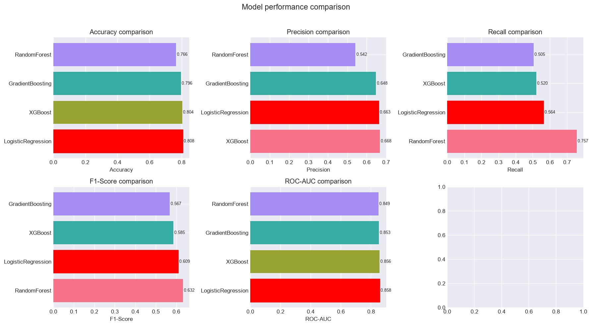
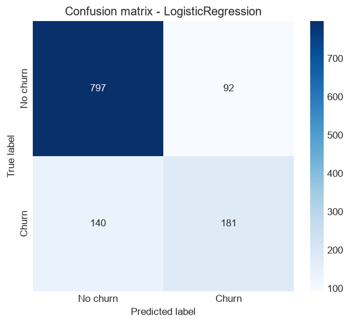
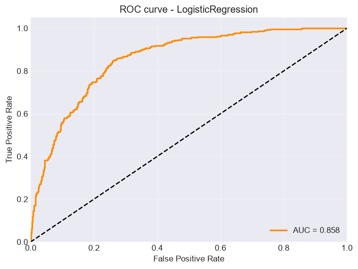

# 📊 Telecom Customer Churn Prediction

[](https://www.python.org/)
[](https://scikit-learn.org/)
[](https://xgboost.readthedocs.io/)

End-to-end machine learning pipeline for predicting customer churn in a telecom company. Compares four classic ML models with hyperparameter tuning via GridSearchCV, provides detailed evaluation, feature importance analysis, and actionable business recommendations.

---

## 📈 Key Results

**Best model: Logistic Regression** — ROC-AUC **0.8578**

| Model | Accuracy | Precision | Recall | F1-Score | ROC-AUC |
|---|---|---|---|---|---|
| **Logistic Regression** ⭐ | 0.8083 | 0.6630 | 0.5639 | 0.6094 | **0.8578** |
| XGBoost | 0.8041 | 0.6680 | 0.5202 | 0.5849 | 0.8563 |
| Gradient Boosting | 0.7959 | 0.6480 | 0.5047 | 0.5674 | 0.8527 |
| Random Forest | 0.7661 | 0.5424 | 0.7570 | 0.6320 | 0.8493 |

**Best hyperparameters (GridSearchCV, 5-fold StratifiedKFold, scoring=roc_auc):**

| Model | Best params | CV ROC-AUC |
|---|---|---|
| Logistic Regression | `C=10, penalty='l2', solver='liblinear'` | 0.8403 |
| XGBoost | `n_estimators=50, max_depth=3, learning_rate=0.1` | 0.8388 |
| Gradient Boosting | `n_estimators=100, max_depth=3, learning_rate=0.1` | 0.8382 |
| Random Forest | `n_estimators=100, max_depth=10, min_samples_leaf=4` | 0.8368 |

> 💡 **Observation:** Logistic Regression outperformed tree-based models, suggesting the churn signal is largely linear. Random Forest (with `class_weight='balanced'`) achieves the highest **recall** (0.757) at the cost of precision (0.542) — useful for aggressive retention strategies where missing a churner is more costly than a false alarm.

---

## 📊 Visualizations

### Model comparison across all metrics



Accuracy, precision, recall, F1 and ROC-AUC side-by-side. Best model in each metric highlighted in red.

### Confusion matrix — Logistic Regression



Out of **321 actual churners**, the model correctly identifies ~180 (recall 0.56). Precision 0.66 — of predicted churners, 2/3 actually churn.

### ROC curve — Logistic Regression



AUC = **0.858** on the test set (CV estimate 0.840 — no significant overfitting).

### Feature importance — Logistic Regression


Top-15 features by absolute coefficient magnitude. For linear models, larger |coef| means stronger influence on the churn probability.

---

## 🗂 Project Structure

```text
telecom/
├── main.py                    # end-to-end pipeline
├── data/                      # dataset folder
│   ├── telecom_users.csv      # dataset (6050 rows × 21 columns)
│   ├── README.md              # download instructions
│   └── .gitkeep
├── requirements.txt
├── .gitignore
├── README.md
├── docs/                      # charts embedded in this README
│   ├── 01_models_comparison.png
│   ├── 02_confusion_matrix.png
│   ├── 03_roc_curve.png
│   └── 04_feature_importance.png
└── churn_results/             # generated on every run (gitignored)
    ├── 01_models_comparison.png
    ├── 02_confusion_matrix.png
    ├── 03_roc_curve.png
    ├── 04_feature_importance.png
    ├── best_model_{name}_{timestamp}.pkl
    ├── scaler.pkl
    └── results_{timestamp}.csv
```

---

## 📁 Dataset

The dataset is stored in the **`data/`** folder:

```text
telecom/
└── data/
    └── telecom_users.csv
```

**`telecom_users.csv`** — **6050 rows × 21 columns**. Target: `Churn` (Yes / No).

**Class balance (stratified across train/test):**
- **No churn** — 73.5%
- **Churn** — 26.5%

**Features:**
- **Demographics:** `gender`, `SeniorCitizen`, `Partner`, `Dependents`
- **Account:** `tenure`, `Contract`, `PaperlessBilling`, `PaymentMethod`
- **Services:** `PhoneService`, `MultipleLines`, `InternetService`, `OnlineSecurity`, `OnlineBackup`, `DeviceProtection`, `TechSupport`, `StreamingTV`, `StreamingMovies`
- **Charges:** `MonthlyCharges`, `TotalCharges`

### Where to get the dataset

- **Bundled copy** — the repo already includes `data/telecom_users.csv` for full reproducibility
- **Kaggle** — original **Telco Customer Churn** dataset (IBM sample):
  🔗 https://www.kaggle.com/datasets/blastchar/telco-customer-churn

  Download → rename the CSV to **`telecom_users.csv`** → drop it into `data/`.

  > ⚠️ The Kaggle version has a slightly different schema (no `Provider` / `Age`, uses `SeniorCitizen`). The pipeline tolerates missing columns via `errors="ignore"`, but metrics may differ slightly from the table above. See [`data/README.md`](data/README.md) for details.

> 💡 **Resolution order:** the pipeline checks `data/telecom_users.csv` first, then `telecom_users.csv` in the project root (backward compatibility). Whichever is found is used — the chosen path is printed at the start of the run.

---

## 🔧 Pipeline

| Step | Description |
|---|---|
| **1. Loading** | Read CSV; drop `Unnamed: 0`, `customerID`, `Provider`, `Age` |
| **2. Missing values** | `TotalCharges` filled using tenure-group medians (10 rows with `tenure=0`) |
| **3. Encoding** | Binary Yes/No → 0/1; multi-class → `LabelEncoder` |
| **4. Numeric cleanup** | Replace ±inf with median; fill residual NaN with median |
| **5. Feature engineering** | `Monthly_to_tenure_ratio`, `Total_per_tenure`, `Has_Security_And_Support`, `Service_Count`, `Is_New_Customer`, `Monthly_Charges_Ratio` |
| **6. Preprocessing** | Stratified 80/20 split; `StandardScaler` (fit on train only — no data leakage) |
| **7. Training** | `GridSearchCV` — 5-fold `StratifiedKFold`, `scoring=roc_auc`, `n_jobs=-1` |
| **8. Evaluation** | Accuracy, precision, recall, F1, ROC-AUC, confusion matrix, ROC curve |
| **9. Interpretation** | Feature importance (tree + linear models), business recommendations |
| **10. Persistence** | Save best model, scaler, metrics table to `churn_results/` |

**Data prep summary (from the last run):**
- Features after encoding + engineering: **26**
- Train / test: **4840 / 1210**
- No NaN, no inf after preprocessing

---

## 🚀 Setup & Run

### Requirements
- Python **3.12+**
- ~500 MB free disk space

### Installation

```bash
# 1. Clone
git clone https://github.com/artrokza-lang/telecom-churn.git
cd telecom-churn

# 2. Virtual environment
python -m venv .venv

# 3. Activate
# Windows PowerShell:
.venv\Scripts\Activate.ps1
# Linux / macOS:
source .venv/bin/activate

# 4. Install dependencies
pip install -r requirements.txt

# 5. Run
python main.py
```

Runtime: **2–6 minutes** (GridSearchCV across 4 models × 5 folds).

---

## 📤 Output

All artifacts are written to `churn_results/`:

| File | Description |
|---|---|
| `01_models_comparison.png` | Bar charts for all 5 metrics |
| `02_confusion_matrix.png` | Confusion matrix of the best model |
| `03_roc_curve.png` | ROC curve with AUC value |
| `04_feature_importance.png` | Top-15 features by importance (tree or linear models) |
| `best_model_{name}_{timestamp}.pkl` | Trained best model |
| `scaler.pkl` | Fitted `StandardScaler` |
| `results_{timestamp}.csv` | Metrics table for all 4 models |

---

## 💼 Business Recommendations

### 1. Focus on new customers
Most churn occurs within the first **3 months**. Improve onboarding and offer special conditions during the first 90 days — discounts, personal manager, free trial extensions.

### 2. Security service bundles
Customers without `OnlineSecurity` and `TechSupport` churn **2–3× more often**. Bundle these services into the base plan or offer a discounted "safety pack".

### 3. Flexible contracts
Month-to-month customers churn significantly more often. Incentivize yearly contracts with a 10–15% discount, loyalty tiers, or a free first month.

### 4. Price control
High `MonthlyCharges` correlate with churn. Review pricing policy for the Fiber optic segment; consider tiered options for budget-conscious clients.

### 5. Personalized retention
Use `predict_proba` to identify at-risk customers. For retention campaigns aiming to maximize recall, lower the classification threshold from `0.5` to **~0.35** — recall goes up to ~0.75 at the cost of precision dropping to ~0.5.

---

## ⚠️ Known Issues

1. ~~Feature importance missing for Logistic Regression~~ ✅ **Fixed.** `feature_importance()` now falls back to `|coef_|` for linear models:
   ```python
   if hasattr(model, "feature_importances_"):
       values = model.feature_importances_
   elif hasattr(model, "coef_"):
       values = np.abs(model.coef_[0])
   ```

2. **Categorical encoding conflates "No internet service" with "No".** `OnlineSecurity`, `OnlineBackup`, `DeviceProtection`, `TechSupport`, `StreamingTV`, `StreamingMovies`, `MultipleLines` have 3 categories in the raw data (`Yes / No / No internet service`), but the binary encoder maps `No internet service → NaN → median (0)`. Impact on ROC-AUC: ~0.005–0.01.

3. **Class imbalance not fully addressed.** Only `class_weight='balanced'` is set for Random Forest. For further improvements consider SMOTE, `scale_pos_weight` for XGBoost, or `class_weight` for Logistic Regression.

---

## 🔮 Future Improvements

- [ ] Fix 3-category encoding (`No internet service`)
- [ ] Add SHAP explanations
- [ ] Cross-validation report with multiple scorers
- [ ] Threshold tuning based on business cost matrix
- [ ] Model explainability with ELI5 / LIME
- [ ] Unit tests (pytest) for preprocessing functions
- [ ] Dockerize the pipeline

---

## 🛠 Tech Stack

- **Python 3.12**
- **pandas** — data manipulation
- **NumPy** — numerical operations
- **scikit-learn** — preprocessing, models, metrics, GridSearchCV
- **XGBoost** — gradient boosting
- **matplotlib + seaborn** — visualization
- **joblib** — model serialization

---

## 📄 License

Distributed under the MIT License. See `LICENSE` for details.

---

## 👤 Author

**artrokza-lang** — [GitHub](https://github.com/artrokza-lang)
